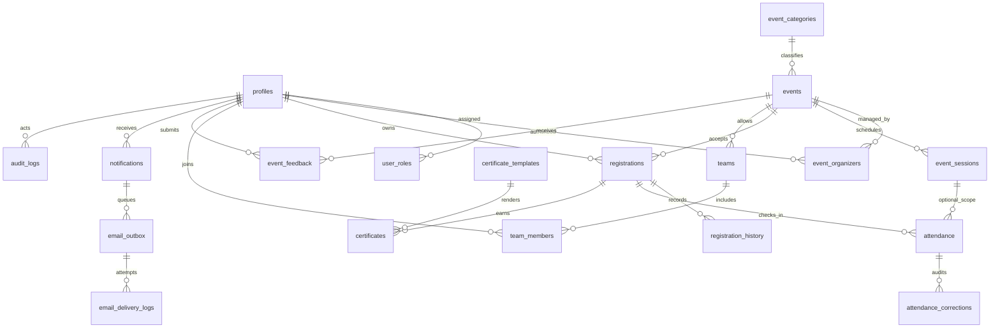

# Architecture and database design

## Boundaries
React/strict TypeScript + Vite + Tailwind → Supabase publishable client → managed Auth and Postgres RLS. Role checks in the UI improve navigation only; the database enforces identity and authorization. Supabase Auth owns passwords and sessions. Event operations run in transaction-safe RPC functions. Edge Functions handle mail-provider credentials and private PDF generation. No Express backend. No worker/service secret belongs in a VITE_ variable.

Frontend: reusable UI primitives, authentication context, validation module, database types and feature repositories; pages contain presentation. Auth context calls getUser to verify the current session before loading RLS-protected profile/role data. Missing config does not fall back to demo data. A recovery gate is set only by the Auth PASSWORD_RECOVERY event, cleared on use/signout and expires after 15 minutes.

## Identity entities
- profiles: auth.users FK, unique normalized email and unique 12-character RRN, permitted profile fields, active flag, timestamps. No password column.
- user_roles: composite user_id/role primary key, assignment time and granting actor. Role is student/organizer/admin. No browser write policy.
- audit_logs: immutable restricted audit of role changes and trusted account lifecycle. Never passwords, JWTs, QR tokens or raw auth metadata.
- private.is_active_verified, private.has_role: fixed search_path security-definer helpers. They check the current actor against auth.users confirmation and the active profile; callers cannot choose an actor.

Auth insert trigger validates the email and metadata in trusted Postgres logic and creates only the student role. Transaction failure rolls back account creation. Identity fields and activation state are protected by a profile trigger in addition to column privileges. Browser users can update only their own name, department and study year. Login is blocked in the UI if email is not verified; database helpers independently deny access. Only admin can read audit records. No direct role-table mutation is exposed. The approved-admin command validates authorization before changing another verified account’s roles. SQL owner role assignment is deliberately separate from frontend code.

## Implemented relational schema

Events: category FK RESTRICT, creator, UTC event/registration ranges, capacity >0, eligibility configuration, registration mode, team size bounds, cancellation cutoff, attendance threshold, feedback settings, state and archival timestamps. Required date checks at database boundary. Category deactivation preserves historical references.

Registrations: event/student uniqueness including cancelled history (reactivation through same trusted function); unpredictable unique reference; confirmed/waitlisted/cancelled states; team FK where appropriate. Every create/cancel/promote locks event row before count or seat change; all team member seats are reserved together. Waitlist promotion FIFO under the same lock and revalidates eligibility. Uniqueness prevents duplicate registration; repeated registration rejects an existing active record. Certificate, notification and delivery retries have explicit idempotency mechanisms. Notifications/outbox entries commit in the registration transaction.

Teams/member invitations: event-scoped uniqueness, leader membership, consented invitations, no browser adding arbitrary students; freeze valid membership during registration. Session attendance uses two partial unique indexes (event-level registration, session-level registration+session) to avoid NULL uniqueness holes; composite relationships ensure session belongs to event. Corrections retain actor, prior state and reason. Tokens are opaque random secrets; only hashed values persist, displayed through a controlled retrieval/rotation flow. No PII in QR.

Certificates: registration/type uniqueness and unique random verification ID, private object key, template version, approved signatory snapshot supplied by actual authorized personnel, eligibility evidence, issuance and revocation metadata. Public verification RPC exposes minimal certificate status/event/approved display name, no email/RRN/private path. Signed PDF URLs are time limited and owner/authorized-staff only. No certificate issuance on registration alone.

Feedback: one user/event response, ratings 1–5, bounded comments, completed-event/attendance eligibility checked in trusted function, owner read and authorized-event staff access only. Outbox: durable status, attempt count, next retry, lock lease, stable provider idempotency key and dead-letter handling. CSV exports guard formula prefixes. All private tables have RLS enabled. Private module table privileges are revoked from browser roles; trusted RPCs independently check actor and operation scope.

## Event lifecycle
Draft → Published: organizer, complete fields, valid dates, assigned staff. Published → Registration Closed: registration close reached (computed effective status, not a security dependency on scheduler). Closed → Ongoing: start reached. Ongoing → Completed: event ended and authorized finalization. Any nonterminal state → Cancelled: authorized reason and transactional notifications. Completed/Cancelled terminal; changes require a separately audited administrative recovery, not a normal edit. Registration checks actual timestamps and cancelled/unpublished state regardless of scheduler.

## Reporting and reliability
Authorized aggregates in Postgres; pagination in every row listing; indexes on FKs and query predicates. Daily backups/PITR depend on actual Supabase subscription. Release requires migration and restore rehearsal. No cloud, provider, production storage or official roster connection has been established in this environment.

## API and privileged operations
`portal_public` exposes only published/non-draft events, categories, sessions and minimal certificate verification. `portal_read` authenticates the current verified active subject, scopes reads and uses server aggregates. `portal_command` authenticates, counts rate-limited attempts outside an inner write subtransaction and dispatches independently authorized operations. Rejected inner operations return an explicit error object which the UI and PDF handler treat as failure. `portal_*_core` functions are not executable by browser roles.

Every registration/cancellation/promotion serializes on the event row. Teams reserve all participant seats in one transaction. Partial attendance indexes handle null event-level sessions correctly; composite FKs prevent cross-event session/registration combinations. Certificate identity trigger binds user/event to the registration; event and certificate locks recheck finalized eligibility. A generation lease prevents concurrent pending PDF writers; a service-only completion validates lease token and the exact private path, records the document’s actual issuance timestamp and notifies the owner. Revoked certificates fail public validity checks.

The email worker claims up to five leased jobs with SKIP LOCKED, uses stable Resend idempotency keys, records errors/retry delays, and stops automatic retries before the provider’s 24-hour deduplication horizon. Reminders deduplicate per recipient/event/lead time. Database `delivered` currently means provider API acceptance, not independently confirmed inbox delivery. No webhook delivery tracking is claimed.

Storage provisioning is conditional only to support the narrower genuine PostgreSQL verification environment. Full Supabase release must actually create/check both private buckets and every policy. Browser certificate writes are forbidden; short-lived reads require issued status and owner/event-manager authorization. Server credentials never enter the frontend.

Extra implemented tables: organizer_requests, support_issues and private.operation_limits. Official roster records, templates, categories and settings are empty until authorized operators provide actual values.
